# IV. Software Design Description

GrainLedger — SDD design revision 0.3, 16 October 2026. The presentation follows the SDD example in Sources.docx. Repository context identifies existing technologies, modules, endpoint/persistence boundaries and receiving behavior. Unfinished workflows remain fully specified as planned target design, not removed or claimed complete. Source conflicts and exact file references are recorded in repository_context_vi.md.

## 1. System Design

### 1.1 System Architecture

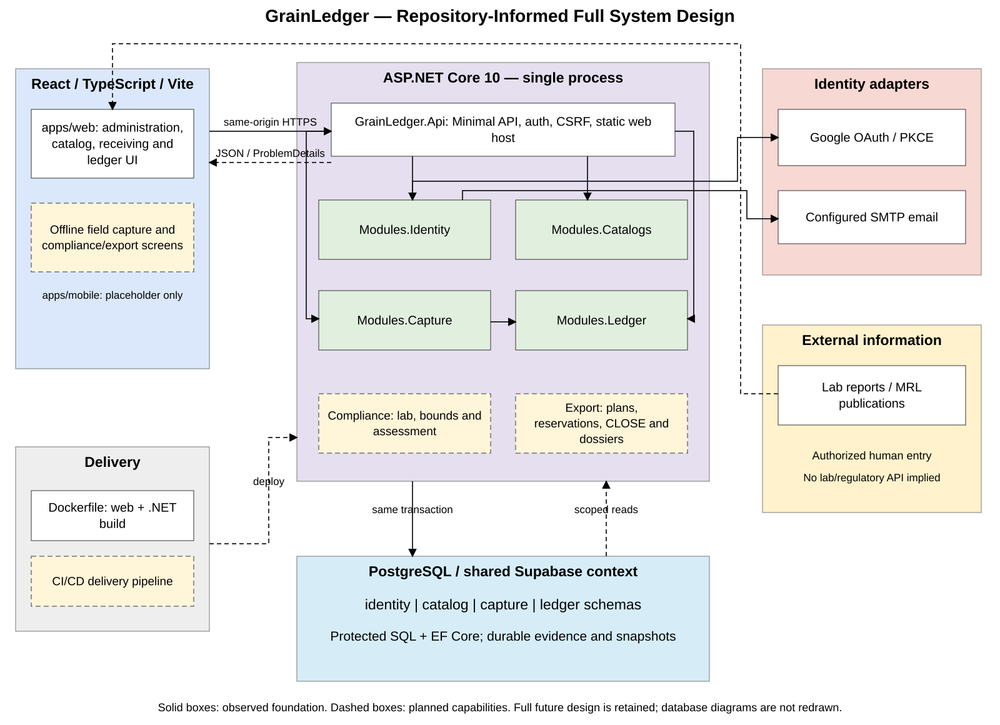

Diagram 1: System Architecture

**Component Explanations**

**Application topology:** The source repository establishes a modular monolith: ASP.NET Core 10 host GrainLedger.Api with Identity, Catalogs, Capture and Ledger class-library modules, each owning a schema and migrations. Planned compliance/export capabilities remain in-process design responsibilities; their project split is not yet implemented.

**Frontend:** apps/web is React + TypeScript + Vite. The same-origin production host serves its static build; development Vite proxies /api and /signin-google. Mobile-friendly web capture is the target surface for offline work; apps/mobile is currently a placeholder.

**Request and authorization boundary:** Minimal API endpoint mappings invoke feature handlers, DbContexts or LedgerService. The repository does not implement a universal MVC Controller → Service → Repository stack. Persisted active role, named permission, customer owner and assigned facility are checked server-side. Browser cookies are HttpOnly; cookie mutations require X-CSRF-TOKEN. JWT Bearer access is a separate API-client path.

**Identity and external authentication:** Identity owns Google authorization-code/PKCE handling, local email/password verification/recovery through configured SMTP, persisted sessions and permission/access changes. Google and SMTP are actual supported adapters. No provider credentials are exposed to React.

**Catalogs and Capture:** Catalogs owns canonical commodities, units, reference attributes and MRL versions. Capture owns farmer/plot/season/spray and immutable procurement source expectations. Procurement registration commits a source package and pending-receiving projection; it does not create usable Ledger stock.

**Ledger and accepted arrivals:** LedgerEndpoint handlers call LedgerService.CommandAsync, ReadAsync or ReceivingAsync. Npgsql invokes protected ledger.command, ledger.read and ledger.arrival_command routines. Complete actual arrival measurements either match exactly and post actual mass, or await assigned MillManager review. Only supported shortage approval posts actuals; surplus/zero/full-loss acceptance is not added.

**Persistence and transaction contract:** PostgreSQL is the runtime store; shared Supabase is the configured team environment, not an extra business service. Source/stock changes share one connection and caller-owned READ COMMITTED transaction. Advisory lock 714928352 is acquired before source/stock rows; module routines do not commit a caller transaction. LedgerService can invoke a protected routine in one database statement transaction; a routine never independently commits a shared Capture transaction. Target reservations, approvals and CLOSE must join this protection rather than bypass it.

**Numbers, history and evidence:** Mass crosses the API as decimal strings and is exactly numeric(20,6) in kg. Original quantity/unit and accepted observations remain retained. Source attribution uses integer micro-kg largest remainders, including allocation of each input share across root source contributions. Existing evidence content is retained in ledger.evidence with digest and scoped access; generic file evidence is not a completed laboratory residue model.

**Planned business capabilities:** Lab/cohort bounds, residue propagation, export planning/approval, INPUT/OUTPUT reservations, loading, whole-container CLOSE/dossiers and complete container traceback remain full target design in Sections 3.5–3.8. A published MRL resolver and physical blending are existing building blocks, not proof that export compliance/planning is implemented. Lot HOLD exists; container HOLD and full downstream effects require the target extension.

**Build, deployment and external information:** The Dockerfile builds the web frontend and .NET host into a container. CI/CD remains a delivery requirement, not a claimed existing pipeline vendor. Production uses same-origin HTTPS behind a trusted reverse proxy. Laboratory reports and regulatory MRL publications remain human-mediated information sources; no direct lab/regulatory connector is assumed.

### 1.2 Package Diagram

The package diagrams below are authored and exported with PlantUML using its native package/folder notation. Dashed planned boxes and explicit planned labels identify unfinished target capabilities. The diagrams preserve the source groups, containment and dependencies of the pre-conversion diagrams; hidden links in the PlantUML sources only control layout. File groups in the flat frontend are shown explicitly as source groups, not as directories that already exist. Dependencies cross module boundaries through in-process contracts; EF entities remain within their owning module.

#### 1.2.1 Backend Package Diagram

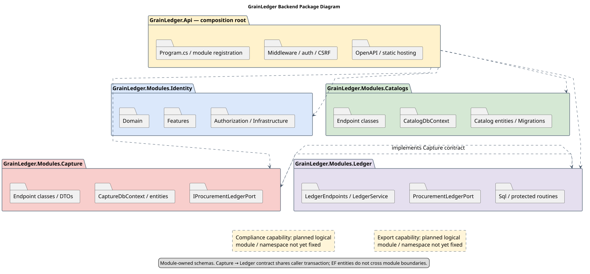

Diagram 2: Backend Package Diagram

PlantUML source: [04_packages_core.puml](diagrams/04_packages_core.puml).

**Package Descriptions**

| No | Package | Description |
| --- | --- | --- |
| 01 | GrainLedger.Api | Existing composition root: ASP.NET Core 10 Minimal API host, middleware/authentication, module registration, same-origin static web hosting and development OpenAPI/Scalar. |
| 02 | GrainLedger.Modules.Identity | Existing module. Owns identity schema, users/organizations, permissions, cookie/JWT sessions, local/Google authentication and administration. |
| 03 | Identity.Domain / Features / Authorization | Existing directories. Domain/User, Organization, LoginSession; Features/Authentication, Profile, Administration; persisted permission/scope resolution. |
| 04 | Identity.Infrastructure / Common | Existing directories. EF Core IdentityDbContext, cookie/JWT/CSRF adapters, SMTP email sender, request/error helpers. |
| 05 | GrainLedger.Modules.Catalogs | Existing module. Endpoint classes, catalog entities and CatalogDbContext in the module root; commodity/unit/substance/market/quality/variety and versioned MRL APIs. |
| 06 | GrainLedger.Modules.Capture | Existing module. Endpoint classes, EF entities, CaptureDbContext, request/response records and capture schema. Keeps immutable procurement source expectations distinct from accepted physical stock. |
| 07 | Capture.IProcurementLedgerPort | Existing in-process interface in ProcurementLedgerPort.cs; RegisterPendingAsync uses the caller connection/transaction. No EF entities cross the boundary. |
| 08 | GrainLedger.Modules.Ledger | Existing module. LedgerEndpoints and LedgerManagementEndpoints, LedgerService, ProcurementLedgerPort/CommodityLedgerPort, protected reads/commands and evidence handling. |
| 09 | Ledger.Sql | Existing SQL resource directory: Schema, Operations, Commands, Reads, PhysicalReceiving, CorrectionBinding and later migrations define protected state, postings and logical domain records. |
| 10 | Module migrations and DbContexts | Existing module-owned persistence/migration history. Identity, Catalogs and Capture use EF domain persistence; LedgerDbContext supports migrations while runtime LedgerService uses Npgsql/protected SQL. |
| 11 | Compliance capability (planned logical module) | Target design for lab/cohort/propagation/assessments; consumes Catalogs MRL references and actual accepted Ledger quantities/lineage. No corresponding project is present yet; final project/namespace split remains a design decision. |
| 12 | Export capability (planned logical module) | Target order/plan/review/reservation/loading/CLOSE/dossier coordination in the same host, sharing the protected transaction boundary. No corresponding project is present yet. |
| 13 | Trace/container-HOLD extensions (planned) | Extend Ledger lineage/HOLD/history to complete lab-to-container and container-to-plot workflows; current lot HOLD does not automatically cascade. |

Table 1: Backend Package Descriptions

API composition references all four existing modules. Ledger implements the interface owned by Capture (compile-time dependency Ledger → Capture); the runtime call crosses Capture → its registered Ledger port. No ORM entity crosses this boundary.

#### 1.2.2 Frontend Package Diagram (Website)

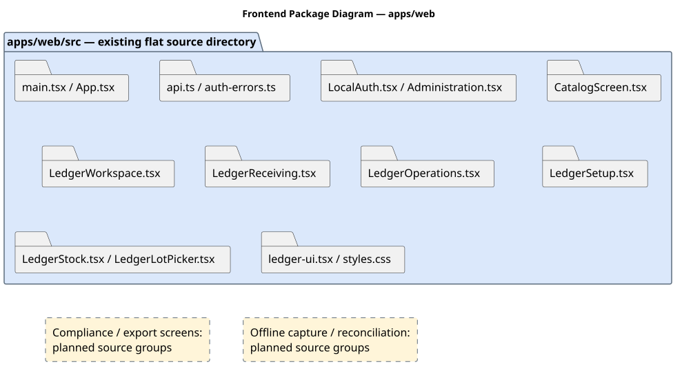

Diagram 3: Frontend Package Diagram (Website)

PlantUML source: [03_packages_workspace.puml](diagrams/03_packages_workspace.puml).

**Package Descriptions**

| No | Package | Description |
| --- | --- | --- |
| 01 | apps/web/src/main.tsx; App.tsx | Existing React/TypeScript entry point, restored session, scope-aware navigation and page composition; built using Vite. |
| 02 | src/api.ts; auth-errors.ts | Existing same-origin fetch wrapper: HttpOnly session cookies, X-CSRF-TOKEN on mutations, session-generation checks and ProblemDetails errors. No access token is stored in local storage. |
| 03 | src/LocalAuth.tsx; Administration.tsx | Existing local-auth/account and role/organization-access screens; Google login is brokered by backend Identity. |
| 04 | src/CatalogScreen.tsx | Existing catalog and versioned MRL screens. |
| 05 | src/LedgerWorkspace.tsx; LedgerReceiving.tsx | Existing task workspace and source-registration / actual-arrival measurement / manager-review interface. |
| 06 | src/LedgerOperations.tsx; LedgerSetup.tsx | Existing processing/draft/correction/transfer and configuration screens. |
| 07 | src/LedgerStock.tsx; LedgerLotPicker.tsx | Existing stock, HOLD/notices/history views and scoped lot selection. |
| 08 | src/ledger-ui.tsx; styles.css | Existing shared UI/numeric-input/pagination components and responsive styles. These are files in a flat src directory, not invented nested packages. |
| 09 | Compliance/export screens (planned) | Future evidence, bounds, plan review, loading, CLOSE and dossier views; retain the current API/session/error conventions. |
| 10 | Durable offline field capture (planned) | Future local pending storage/reconnection/reconciliation in the mobile-friendly web client. A server CaptureOperation record is present, but the complete offline client is not implemented. |

Table 2: Frontend Package Descriptions (Website)

#### 1.2.3 Frontend Package Diagram (Field Web Client)

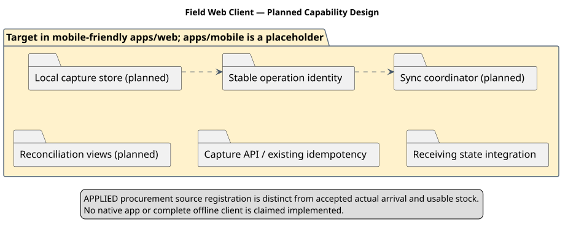

Diagram 4: Frontend Package Diagram (Field Web Client)

PlantUML source: [02_packages_field.puml](diagrams/02_packages_field.puml).

**Package Descriptions**

| No | Package | Description |
| --- | --- | --- |
| 01 | apps/web mobile-friendly capture screens | Existing browser surface to extend; the repository apps/mobile package is a placeholder, not a running native client. |
| 02 | Local capture store (planned) | Persist original pending payload and capture metadata; use stable device/operation identity, dependency ordering and owner isolation. |
| 03 | Synchronization coordinator (planned) | Retry through authenticated Capture endpoint contracts. Procurement registration creates source expectation only; retries never authorize physical stock. |
| 04 | Reconciliation views (planned) | Present same-key changed payload conflict, missing dependencies, pending/rejected outcome and later receiving state without silently merging submissions. |
| 05 | CaptureOperation and existing idempotency contract | Existing capture entity and uniqueness for company/device/client operation. Current procurement endpoint replays same accepted canonical payload; conflict returns 409. General offline lifecycle remains target design. |
| 06 | Receiving projection integration | Use current Ledger receiving state after synchronization; PENDING_ARRIVAL or blocked discrepancy means zero usable stock, not a failed duplicate source record. |

Table 3: Frontend Package Descriptions (Field Web Client)

## 2. Database Design

The existing database diagram is supplied separately in `DBDiagram.png`, with the logical ERD in `all-in-one.svg`. This revision keeps those files unchanged and does not redraw a database diagram, as requested. Existing logical/CLR names map through the owning module DbContext or protected Ledger SQL. Supplied ERD/DB pictures remain conceptual references; current migration source contains later physical-arrival changes and is not redrawn here.

## 3. Detailed Design

Class diagrams retain the example's feature-domain presentation. Existing CLR classes use observed C# names/properties; logical SQL models are explicitly identified because Ledger does not define an ORM entity for every business object. Planned classes/methods are target design. Property-only existing EF entities are not assigned fictional implemented business methods. Sequence lifelines use Minimal API endpoint mappings and actual DbContext/Npgsql boundaries where observed; future service/port names are labelled planned. Complete future scope is preserved regardless of implementation progress.

For source/stock commands, the global write advisory lock and READ COMMITTED contract apply; read-only list transactions need not use the stock-write contract. MRL publication has its own per-version/pair locking and ETag checks. Browser UI guards never replace persisted authorization.

### 3.1 Administration and Versioned Reference Data

**Design status:** Repository-backed foundation: Identity/Catalogs administration, facility configuration and MRL publication exist. The complete target administration contract remains in scope.

Use cases: UC-01, UC-02, UC-03, UC-04, UC-05, UC-06. Mill Administrator maintains customer/account grants, facilities/equipment/capacities, operational master data, balance policies and effective-dated published MRL versions. These are administrative commands with distinct validation policies.

#### 3.1.1 Class Diagram


Diagram 5: Administration and Versioned Reference Data Class Diagram

**Class Specifications**

| No | Class | Attributes | Implementation / behavior |
| --- | --- | --- | --- |
| 01 | Organization | Guid Id; string Name; OrganizationKind Kind; DateTimeOffset CreatedAt | Existing property-only domain/EF model; behavior is in endpoint handlers, services or protected routines. |
| 02 | User | Guid Id; string Email; string DisplayName; string? Role; Guid? OrganizationId; bool IsActive; Guid Version | Existing property-only domain/EF model; behavior is in endpoint handlers, services or protected routines. |
| 03 | MrlVersion | Guid Id; Guid MarketId; Guid CommodityId; int VersionNo; string Status; DateTimeOffset EffectiveFrom; DateTimeOffset? EffectiveTo; Guid? PublishedBy; DateTimeOffset? PublishedAt | Existing property-only domain/EF model; behavior is in endpoint handlers, services or protected routines. |
| 04 | MrlLimit | Guid Id; Guid MrlVersionId; Guid SubstanceId; decimal LimitValue; string Unit | Existing property-only domain/EF model; behavior is in endpoint handlers, services or protected routines. |
| 05 | Commodity | Guid Id; string Code; string Name; Guid? CreatedBy; bool IsArchived; uint Version | Existing property-only domain/EF model; behavior is in endpoint handlers, services or protected routines. |
| 06 | MeasurementUnit | Guid Id; string Code; string Name; string QuantityKind; Guid? CreatedBy; bool IsDeleted; uint Version | Existing property-only domain/EF model; behavior is in endpoint handlers, services or protected routines. |

Table 4: Administration and Versioned Reference Data Class Specifications

**Design constraints:**

- Reuse this command structure for UC-01–UC-05 with entity-specific policies; publishing MRLs is not permission to set customer safety margins (UC-22).
- Equipment locations belong to the same facility. Capacity always includes units; silo-compartment capacity is kg.
- One compartment has at most one active owner occupancy. Clear only after zero stock and recorded clearance.
- Changing grants does not permit editing accepted events or historical policy versions.

#### 3.1.2 Publish an effective MRL version

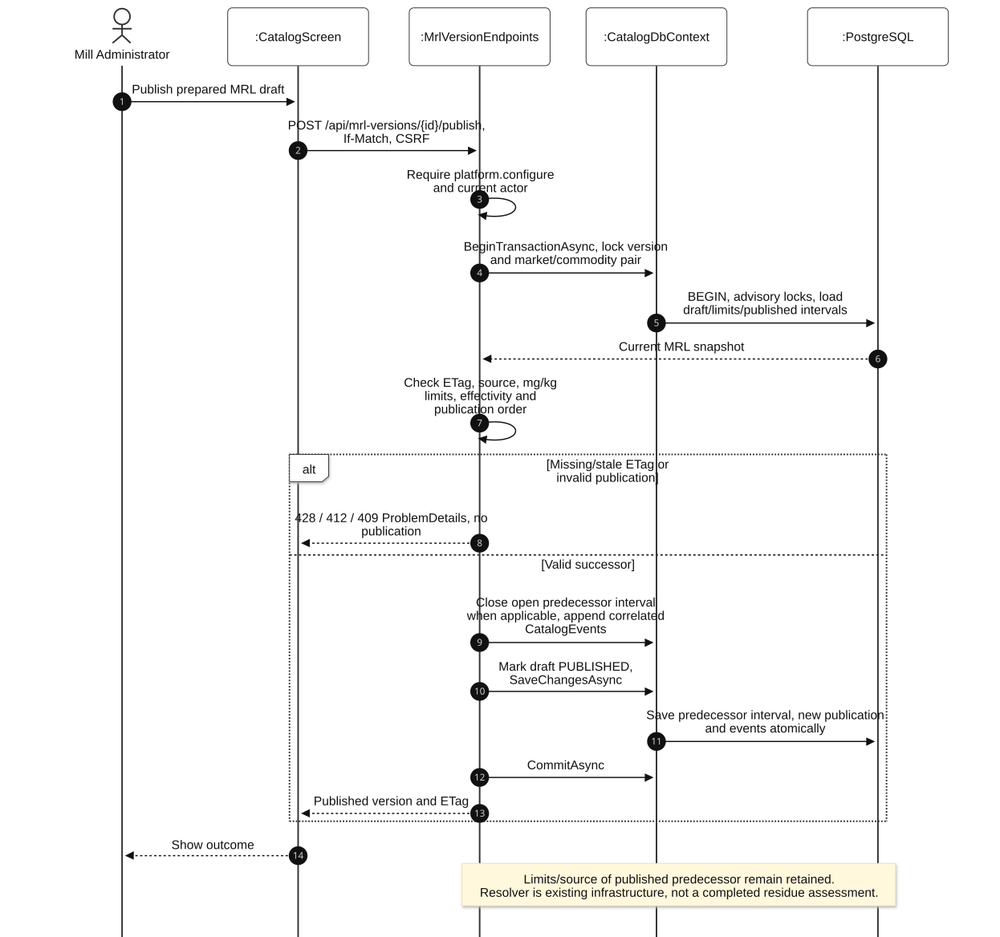

Diagram 6: Publish an effective MRL version Sequence Diagram

### 3.2 Procurement, Field Capture and Offline Synchronization

**Design status:** Mixed: field source registration, procurement idempotency and physical-arrival workflows exist; complete offline capture/sync and sample workflows remain planned. Registration and stock acceptance are separate outcomes.

Use cases: UC-07, UC-08, UC-09, UC-10, UC-11, UC-12. Capture company-scoped farmer/plot/season records, spray declarations and positive procurement expectations. Accepted complete physical arrivals create actual stock later. Offline capture and sampling remain full target-design workflows.

#### 3.2.1 Class Diagram


Diagram 7: Procurement, Field Capture and Offline Synchronization Class Diagram

**Class Specifications**

| No | Class | Attributes | Implementation / behavior |
| --- | --- | --- | --- |
| 01 | Farmer | Guid Id; Guid CompanyId; string Code; string Name; string? Contact; DateTimeOffset CreatedAt; Guid? CreatedBy; int Version; bool IsDeleted | Existing property-only domain/EF model; behavior is in endpoint handlers, services or protected routines. |
| 02 | Plot | Guid Id; Guid CompanyId; Guid FarmerId; string Code; string BoundaryGeojson; decimal AreaHa; Guid? CreatedBy; int Version; bool IsDeleted | Existing property-only domain/EF model; behavior is in endpoint handlers, services or protected routines. |
| 03 | CropSeason | Guid Id; Guid CompanyId; string Name; DateOnly StartsOn; DateOnly EndsOn; Guid? CreatedBy; int Version; bool IsDeleted | Existing property-only domain/EF model; behavior is in endpoint handlers, services or protected routines. |
| 04 | PlotSeason | Guid Id; Guid CompanyId; Guid PlotId; Guid SeasonId; string RiceVariety; Guid? CreatedBy; int Version; bool IsDeleted | Existing property-only domain/EF model; behavior is in endpoint handlers, services or protected routines. |
| 05 | SprayDeclaration | Guid Id; Guid CompanyId; Guid PlotSeasonId; DateOnly AppliedOn; Guid RecordedBy; DateTimeOffset RecordedAt; string? EvidenceRef | Existing property-only domain/EF model; behavior is in endpoint handlers, services or protected routines. |
| 06 | SprayItem | Guid Id; Guid CompanyId; Guid DeclarationId; string? ProductName; Guid? SubstanceId; decimal Rate; string RateUnit | Existing property-only domain/EF model; behavior is in endpoint handlers, services or protected routines. |
| 07 | Procurement | Guid Id; Guid CompanyId; string Code; Guid FarmerId; Guid CollectionSiteId; Guid ReceivedBy; DateTimeOffset ReceivedAt; string Status; Guid? EventId | Existing property-only domain/EF model; behavior is in endpoint handlers, services or protected routines. |
| 08 | ProcurementItem | Guid Id; Guid CompanyId; Guid ProcurementId; int LineNo; Guid PlotSeasonId; decimal NetMassKg; decimal MeasuredValue; string MeasuredUnit; decimal MoisturePercent | Existing property-only domain/EF model; behavior is in endpoint handlers, services or protected routines. |
| 09 | SourceLot | Guid Id; Guid CompanyId; Guid LotId; Guid ProcurementItemId | Existing property-only domain/EF model; behavior is in endpoint handlers, services or protected routines. |
| 10 | CaptureOperation | Guid Id; Guid CompanyId; Guid SubmittedBy; string DeviceId; Guid ClientOperationId; string PayloadHash; string Payload; DateTimeOffset CapturedAt; string? CaptureGeojson; string Status; Guid? AppliedEventId; string? ResultPayload; string? ConflictReason | Existing property-only domain/EF model; behavior is in endpoint handlers, services or protected routines. |
| 11 | ReceivingState | Guid ProcurementId; String Status; Integer Version; Guid AcceptedMeasurementSetId; Guid AcceptedReviewId | existing SQL model; receiving records reflect SQL state, not invented CLR classes. |
| 12 | ArrivalMeasurementSet | Guid Id; Guid ProcurementId; Guid OperatorId; DateTime CapturedAt | existing SQL model; receiving records reflect SQL state, not invented CLR classes. |
| 13 | ArrivalMeasurement | Guid MeasurementSetId; Guid ProcurementItemId; Decimal ActualKg; String MeasuredUnit | existing SQL model; receiving records reflect SQL state, not invented CLR classes. |
| 14 | ArrivalReview | Guid Id; Guid ProcurementId; Guid MeasurementSetId; String Action; Guid EvidenceId; Guid ManagerId | existing SQL model; receiving records reflect SQL state, not invented CLR classes. |
| 15 | Sample | Guid SampleId; Guid SourceLotId; String SealCode; DateTime CollectedAt | Planned sample evidence model; not an existing CLR/SQL type. Confirm persisted sampling linkage before implementation. |

Table 5: Procurement, Field Capture and Offline Synchronization Class Specifications

**Design constraints:**

- UC-07/08/10 reuse the scoped acceptance pattern with field-record/declaration/sample validation; the UC-09 receiving extension creates actual stock only after accepted arrival. Sampling is optional. The planned Sample uses the registered SourceLot identity; exact persisted sampling schema and accepted-material basis require agreement before implementation.
- Submit dependencies in order (farmer/plot/season before dependent receipts; receipt before sample); a missing prerequisite remains visible for reconciliation.
- A stable operation ID identifies one command, not a whole arbitrary offline batch. Source capture APPLIED does not mean physical receiving is accepted. Same-key changed data never creates a second receipt.
- Planned full offline reconciliation must retain rejected/conflicting original payloads without partial source/stock writes. Current procurement idempotency replays APPLIED registration or returns conflict; it is not a completed general offline client lifecycle.

#### 3.2.2 Register procurement source expectation

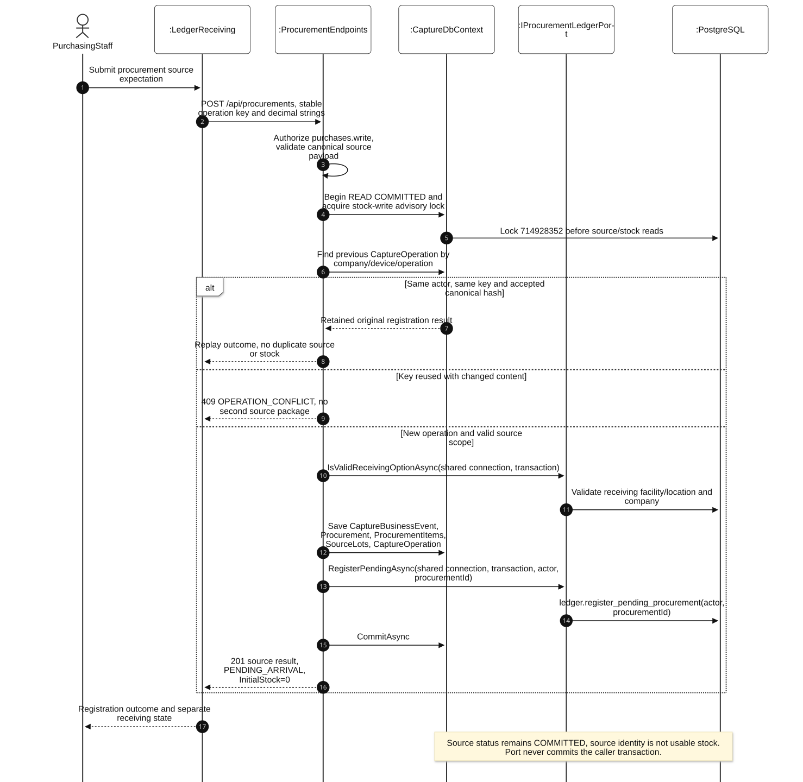

Diagram 8: Register procurement source expectation Sequence Diagram

#### 3.2.3 Offline retention, retry and conflict

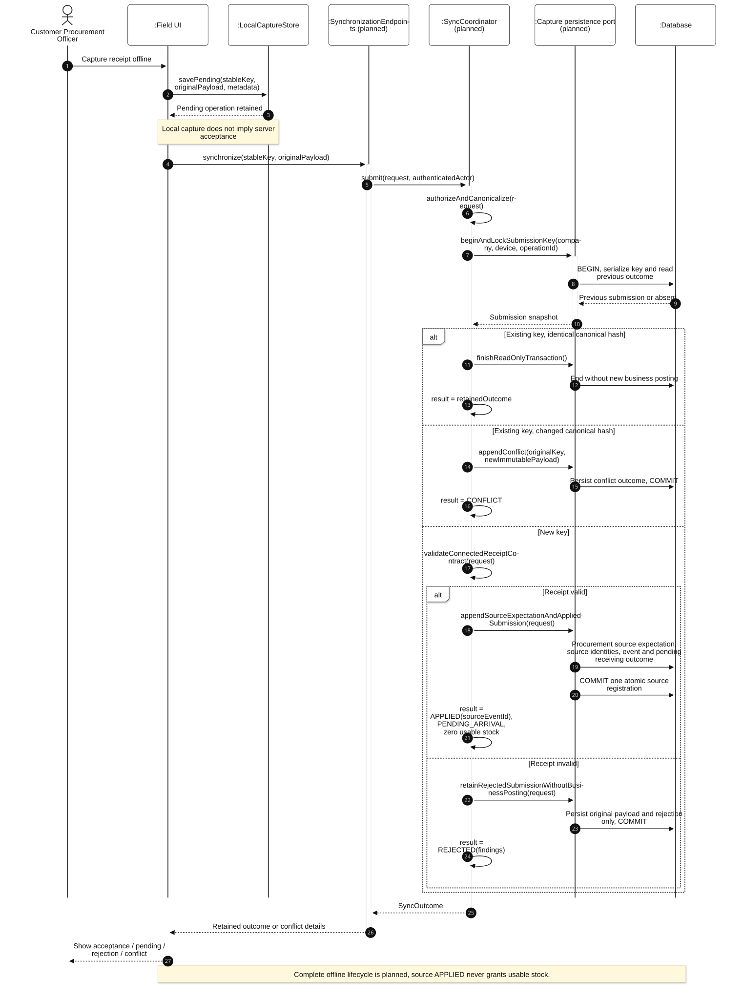

Diagram 9: Offline retention, retry and conflict Sequence Diagram

#### 3.2.4 Measure and review complete physical arrival

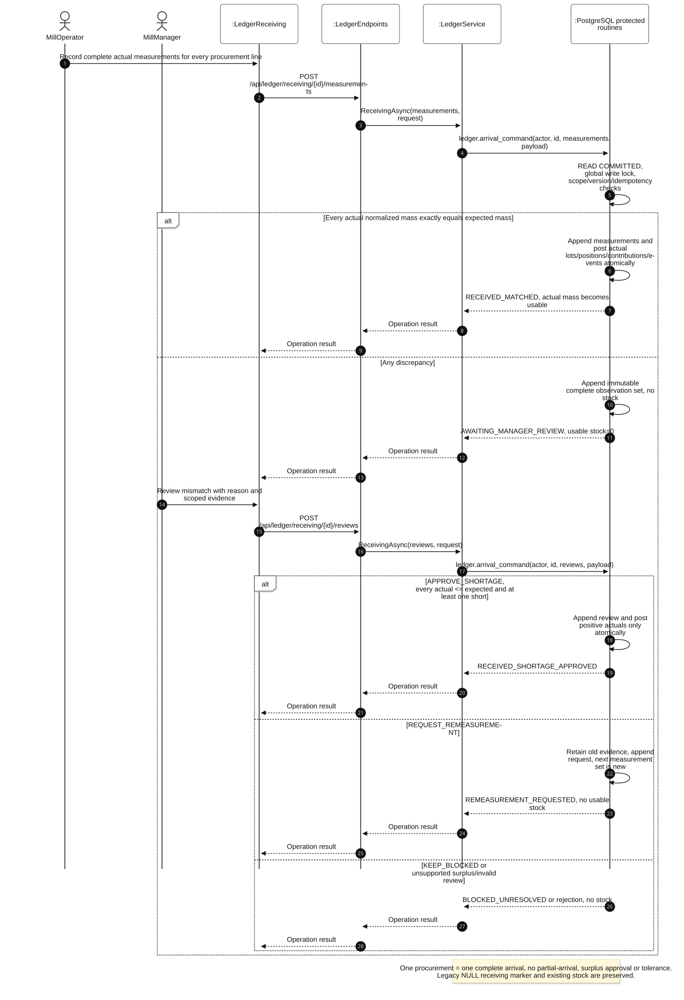

Diagram 10: Measure and review complete physical arrival Sequence Diagram

### 3.3 Physical Operations, Approved Execution and Stock Inspection

**Design status:** Mixed: physical processing, transfers, stock and source-share history exist through LedgerService/protected SQL; approved export-plan scope and reservations remain planned extensions.

Use cases: UC-13, UC-15, UC-18, UC-19, UC-36. A shared ledger acceptance contract handles processing and unchanged-lot transfers. Plan execution additionally requires current scope and matching INPUT reservations. Stock and source composition are read models of committed history.

#### 3.3.1 Class Diagram


Diagram 11: Physical Operations, Approved Execution and Stock Inspection Class Diagram

**Class Specifications**

| No | Class | Attributes | Operations |
| --- | --- | --- | --- |
| 01 | Lot | UUID lot_id; UUID company_id; UUID commodity_id; String lot_code; String stage; DateTime created_at | belongsTo(companyId) Boolean; isStageCompatible(operation) Boolean |
| 02 | LotAllocation | UUID allocation_id; UUID lot_id; UUID location_id; Decimal on_hand_kg | freeMass(outstandingKg) Decimal |
| 03 | Conversion | UUID conversion_id; UUID company_id; UUID plan_id; String conversion_type; String status; Decimal declared_loss_kg; Decimal measurement_variance_kg; String variance_reason; UUID variance_confirmed_by | calculateVariance() Decimal; validateBalance(policy) ValidationResult |
| 04 | ConversionInput | UUID input_id; UUID conversion_id; UUID lot_id; Decimal input_kg; Decimal original_measured_value; String original_unit | validateWithdrawal(movements) ValidationResult |
| 05 | ConversionOutput | UUID output_id; UUID conversion_id; UUID lot_id; Decimal output_kg; Decimal original_measured_value; String original_unit | validateProducedMass() ValidationResult |
| 06 | MassContribution | UUID contribution_id; UUID input_id; UUID output_id; Decimal attributed_output_kg | validateAttribution(outputKg) ValidationResult |
| 07 | InventoryMovement | UUID movement_id; UUID event_id; UUID allocation_id; UUID reservation_id; UUID reverses_movement_id; Decimal delta_kg | isExactReversalOf(original) Boolean |
| 08 | BalancePolicyVersion | UUID balance_policy_id; String conversion_type; Integer version_no; String tolerance_mode; Decimal tolerance_value; DateTime effective_from; UUID confirmed_by | allowedVariance(inputKg) Decimal |
| 09 | StockReservation | UUID reservation_id; UUID plan_allocation_id; UUID plan_output_id; Decimal reserved_kg; Decimal consumed_kg; Decimal released_kg | outstandingMass() Decimal; canConsume(massKg) Boolean |

Table 6: Physical Operations, Approved Execution and Stock Inspection Class Specifications

**Design constraints:**

- For conversion inputs I, outputs O and declared loss L: v = I − O − L; allowed = I × tolerance_value / 100. Require I > 0, positive inputs/outputs, L ≥ 0 and abs(v) ≤ allowed. Nonzero v needs a Mill Manager reason/confirmation.
- Variance is signed reconciliation information, never usable stock and never automatically reclassified as declared loss. Out-of-tolerance input is rejected.
- Attribute output o to input i as output_kg(o) × input_kg(i) / total_input_kg. Round down at the chosen kg precision and assign residual by largest fractional remainder, tie by input_id. Each output attribution sums exactly to its mass. No cycles.
- Transfers preserve lot identity and equal mass at two allocations; physical mixing uses a conversion. A loss-only write-off is outside the baseline.
- on_hand = sum committed movement deltas. outstanding = RESERVE − (CONSUME − REVERSE_CONSUME) − RELEASE. free = on_hand − outstanding. Stock inspection never grants posting authority.
- Missing residue evidence alone does not invalidate a physically valid posting; confirmed risk restrictions and HOLD still apply. Plan execution uses current authority and exact INPUT reservations; standalone conversion may use only free stock.

#### 3.3.2 Validate and atomically post conversion or transfer

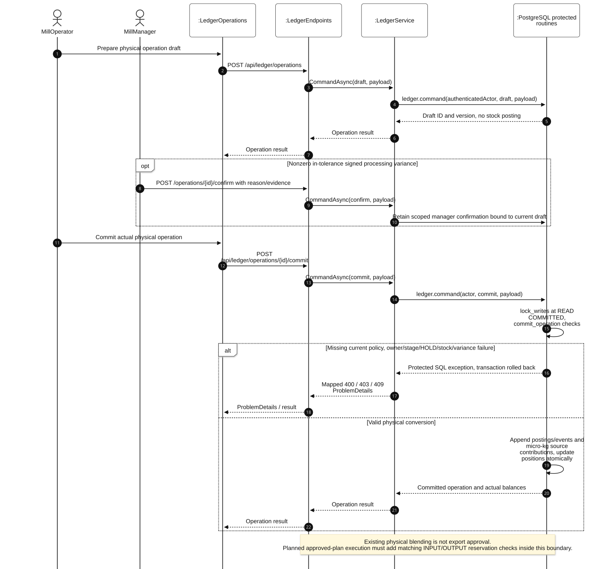

Diagram 12: Validate and atomically post conversion or transfer Sequence Diagram

#### 3.3.3 Execute approved plan scope with target reservations

This sequence retains the complete target workflow, including work not yet implemented. Existing Ledger primitives must be extended inside the same protected transaction boundary; it is not a claim that the shown future endpoint/service/port classes exist.

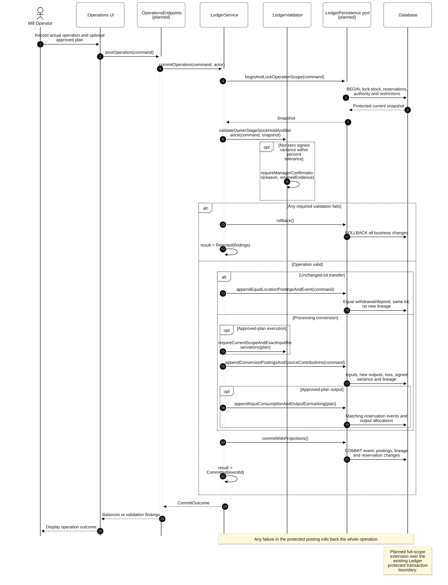

Diagram 13: Execute approved plan scope with target reservations Sequence Diagram

### 3.4 Reconciled Operation Correction

**Design status:** Repository-backed processing-correction flow with target accounting extensions. Current code binds reconciliation to current positions and exact replacement content/version. Export reservation reversal integration remains planned.

Use cases: UC-14, UC-16, UC-17. Request, physical reconciliation and atomic compensation/replacement are separate interactions. A correction lock protects remaining original output stock while evidence is investigated.

#### 3.4.1 Class Diagram

Diagram 14: Reconciled Operation Correction Class Diagram

**Class Specifications**

| No | Class | Attributes | Operations |
| --- | --- | --- | --- |
| 01 | CorrectionRequest | UUID request_id; UUID original_conversion_id; UUID compensation_id; UUID replacement_id; String reconciliation_ref; String outcome | canCommit(reconciliation, downstream) Boolean; validateReplacementScope(plan) ValidationResult |
| 02 | Conversion | UUID conversion_id; UUID company_id; UUID plan_id; String conversion_type; String status; Decimal declared_loss_kg; Decimal measurement_variance_kg; String variance_reason; UUID variance_confirmed_by | calculateVariance() Decimal; validateBalance(policy) ValidationResult |
| 03 | InventoryMovement | UUID movement_id; UUID event_id; UUID allocation_id; UUID reservation_id; UUID reverses_movement_id; Decimal delta_kg | isExactReversalOf(original) Boolean |
| 04 | ReservationEvent | UUID reservation_event_id; UUID reservation_id; UUID movement_id; UUID reverses_event_id; UUID correction_request_id; String event_type; Decimal mass_kg | signedEffect() Decimal; isExactConsumptionReversal(original) Boolean |
| 05 | StockReservation | UUID reservation_id; UUID plan_allocation_id; UUID plan_output_id; Decimal reserved_kg; Decimal consumed_kg; Decimal released_kg | outstandingMass() Decimal; canConsume(massKg) Boolean |

Table 7: Reconciled Operation Correction Class Specifications

**Design constraints:**

- No standalone compensation or automatic downstream rollback. BLOCKED_DOWNSTREAM keeps investigation and restrictions on relevant remaining stock.
- Replacement and compensation are different IDs of the same company; both commit with projection/lineage changes. Historical lineage remains; current lineage uses replacement, without reverse physical edges.
- REVERSE_CONSUME fully reverses one original INPUT CONSUME once; it is not RESERVE. Loading OUTPUT consumption is not reversed by this processing-correction workflow.
- Reuse Section 3.3 validation. Retaining the original plan requires unchanged compatible content, current review and exact reservation quota; otherwise replace outside the old plan and require new export authority.

#### 3.4.2 Request and verify correction

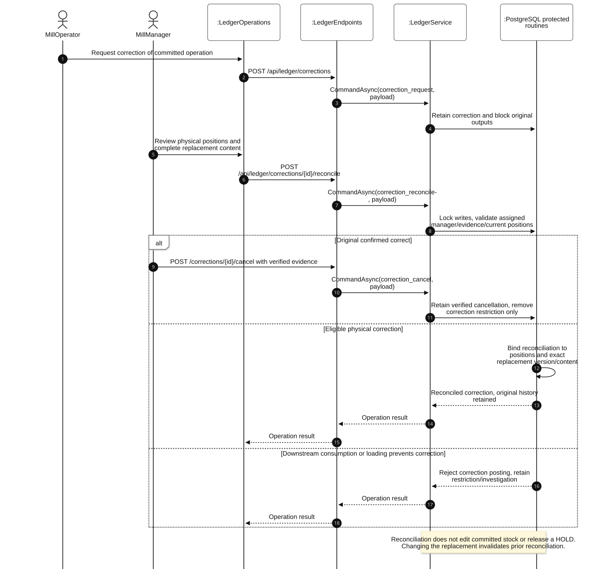

Diagram 15: Request and verify correction Sequence Diagram

#### 3.4.3 Atomic compensation and replacement

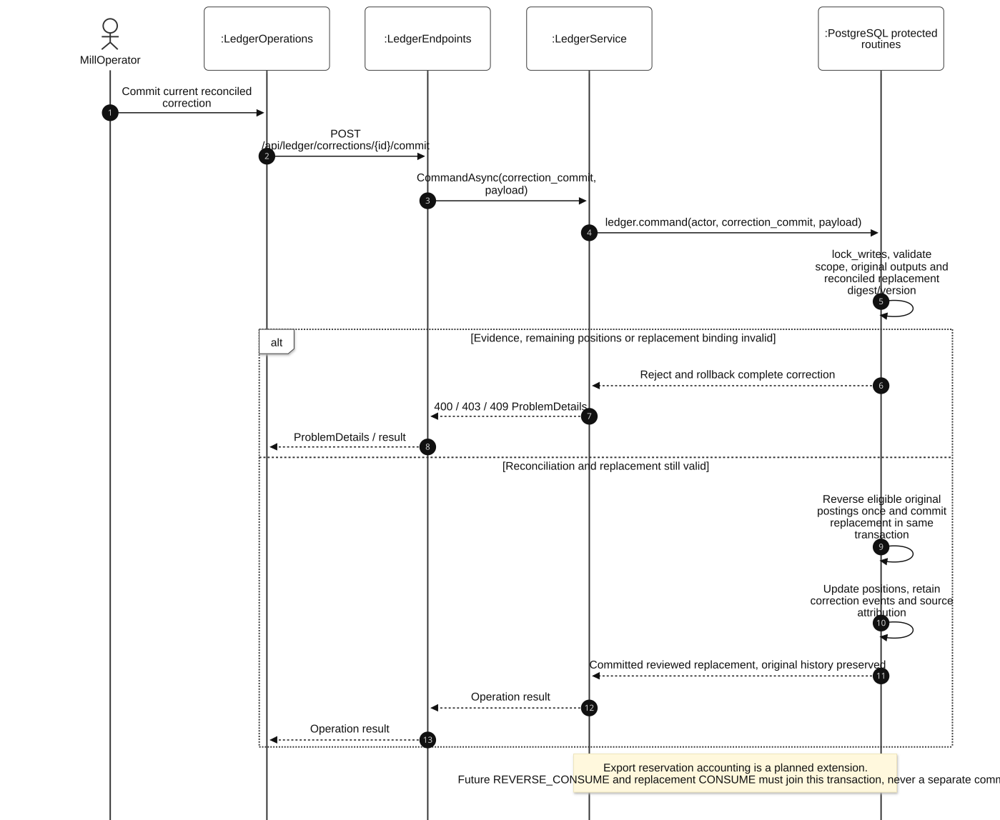

Diagram 16: Atomic compensation and replacement Sequence Diagram

### 3.5 Laboratory Evidence, Residue Bounds and Current Compliance

**Design status:** Planned full compliance design. Published MRL maintenance/resolution exists in Catalogs; ledger.evidence is generic operational evidence. Neither implies completed lab/cohort/residue assessment.

Use cases: UC-20, UC-21, UC-22, UC-37. Maintain laboratory history and customer margin versions, select eligible evidence, propagate supported upper bounds and assess the current decision scope. Bound calculation is deterministic evidence processing, not AI prediction.

#### 3.5.1 Class Diagram


Diagram 17: Laboratory Evidence, Residue Bounds and Current Compliance Class Diagram

**Class Specifications**

| No | Class | Attributes | Operations |
| --- | --- | --- | --- |
| 01 | Sample | UUID sample_id; UUID paddy_lot_id; UUID collected_by; String sample_code; String seal_code; DateTime collected_at | matchesSourceLot(lotId) Boolean |
| 02 | LabReport | UUID lab_report_id; UUID sample_id; UUID supersedes_id; String certificate_number; String laboratory_name; String evidence_ref; DateTime issued_at; DateTime registered_at | canSupersede(original) Boolean |
| 03 | LabResult | UUID lab_result_id; UUID lab_report_id; UUID substance_id; Decimal measured_value; String qualifier; Decimal detection_limit; Decimal quantification_limit | interpretUpperBound(rule) BoundOutcome |
| 04 | Cohort | UUID cohort_id; UUID cohort_policy_id; UUID company_id; UUID collection_site_id; UUID season_id; DateTime window_start; DateTime window_end | matchesScope(lot, policy) Boolean |
| 05 | CohortMember | UUID membership_id; UUID cohort_id; UUID paddy_lot_id | isIncludedIn(snapshot) Boolean |
| 06 | CohortSubstanceBound | UUID cohort_bound_id; UUID cohort_id; UUID substance_id; Integer version_no; Decimal bound_value; String unit; String immutable_membership_ref; String evidence_ref; DateTime confirmed_at | isSupportedBy(evidence) Boolean |
| 07 | LotResidueBoundVersion | UUID bound_id; UUID lot_id; UUID substance_id; Integer version_no; Decimal bound_value; String source_type; String calculation_basis_ref | isEligibleFor(lot, substance, time) Boolean |
| 08 | ResidueEvidenceLink | UUID evidence_link_id; UUID bound_id; UUID lab_result_id; UUID cohort_bound_id; UUID input_bound_id; Decimal source_mass_kg | hasExactlyOneSource() Boolean |
| 09 | PropagationPolicyVersion | UUID propagation_policy_id; UUID commodity_id; String input_stage; String output_stage; String conversion_type; Integer version_no; String calculation_rule | supports(conversion, output) Boolean |
| 10 | ComplianceAssessment | UUID assessment_id; UUID container_id; UUID plan_id; UUID loading_id; String purpose; String verdict; UUID mrl_version_id; UUID safety_margin_policy_id; String immutable_basis_ref | isPassFor(scope, revision) Boolean |
| 11 | SafetyMarginPolicyVersion | UUID safety_margin_policy_id; UUID company_id; UUID market_id; UUID commodity_id; Decimal margin_value; String margin_mode; String unit | threshold(mrl, concentrationUnit) Decimal |

Table 8: Laboratory Evidence, Residue Bounds and Current Compliance Class Specifications

**Design constraints:**

- LAB follows the supplied Sample → PaddyLot model. Any direct laboratory sampling model for processed rice requires an explicit schema decision; it is not silently added here.
- COHORT needs exact recorded membership and matching company/site/season/window, immutable membership snapshot and supported per-substance bound. An observed maximum alone is not a validated operational upper bound.
- CONVERSION uses actual input quantities and bounds for every input, with supported substance/stage/output-commodity propagation. Never assume factor 1 or a milling reduction. Missing rule gives INCOMPLETE for compliance but need not prevent valid physical recording.
- Compatible-basis blends with a supported rule use U(s) = sum(m_i × U_i(s)) / sum(m_i). Quality aggregation is attribute-specific, not universally weighted.
- RELATIVE threshold T = MRL × (1 − r), 0 ≤ r < 1. ABSOLUTE threshold T = MRL − a, a ≥ 0 in compatible units. A negative threshold cannot be passed by nonnegative residue bounds. No default operational margin is introduced.
- Required panel is recorded explicitly; missing limit never means unlimited. MRL must be published, effective and known at decision time. Unresolved independent lab conflicts block PASS.
- UC-22 reuses the versioned configuration pattern in Section 3.1 with Customer Manager scope. UC-21 reuses registration with same-context official supersession checks. Historical assessments are never rewritten.

#### 3.5.2 Current scope assessment

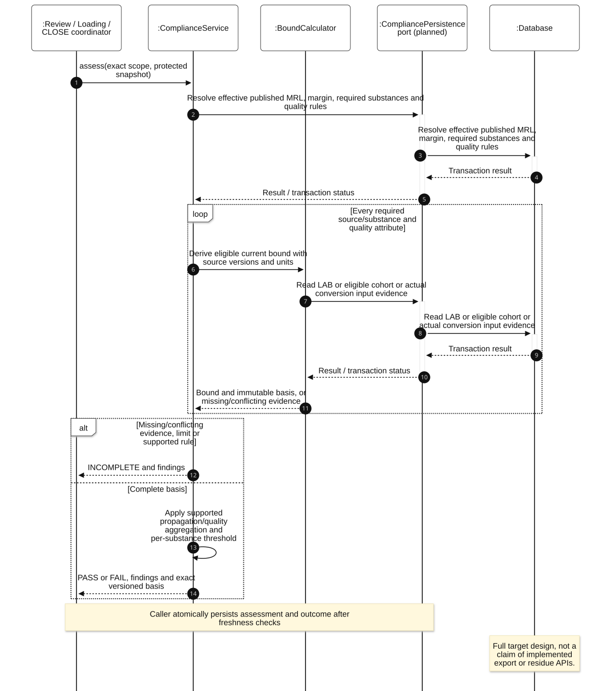

Diagram 18: Current scope assessment Sequence Diagram

#### 3.5.3 Late evidence and affected unfinished authority

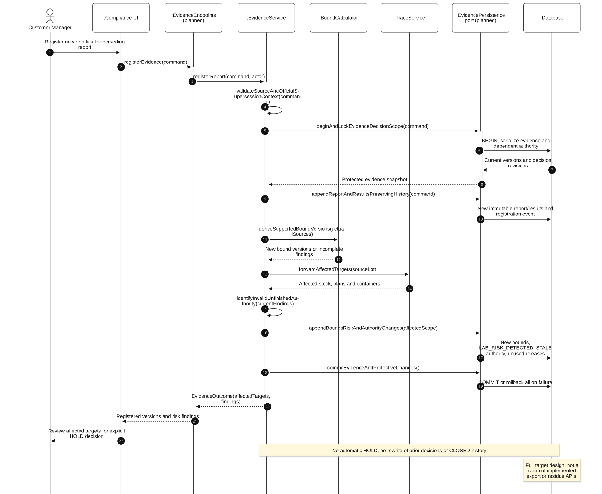

Diagram 19: Late evidence and affected unfinished authority Sequence Diagram

### 3.6 Export Orders, Blend Proposal and Plan Review

**Design status:** Planned full export planning/review/reservation design. ExportStaff is a persisted role; its presence does not imply completed order/planner APIs.

Use cases: UC-23, UC-29, UC-30. Create owner-scoped orders/container targets and versioned specifications, search for a feasible proposal, and review the exact current execution scope. Proposal generation neither consumes stock nor grants loading authority.

#### 3.6.1 Class Diagram


Diagram 20: Export Orders, Blend Proposal and Plan Review Class Diagram

**Class Specifications**

| No | Class | Attributes | Operations |
| --- | --- | --- | --- |
| 01 | ExportOrder | UUID order_id; UUID company_id; UUID market_id; UUID commodity_id; UUID created_by; String order_code; Decimal required_mass_kg | remainingMass(completedKg) Decimal |
| 02 | OrderSpecificationVersion | UUID specification_id; UUID order_id; Integer version_no; DateTime recorded_at | hasRequiredAttributes() Boolean |
| 03 | SpecificationLimit | UUID specification_limit_id; UUID specification_id; UUID attribute_id; Decimal minimum_value; Decimal maximum_value | isSatisfied(value) Boolean |
| 04 | Container | UUID container_id; UUID order_id; String internal_code; String container_number; String seal_number; Decimal target_mass_kg; String status | canAcceptLoading() Boolean; hasExactTarget(loadedKg) Boolean |
| 05 | BlendPlan | UUID plan_id; UUID container_id; UUID specification_id; UUID proposed_by; Integer version_no; String status; String search_outcome | hasCurrentAuthority(scope) Boolean |
| 06 | BlendPlanAllocation | UUID plan_allocation_id; UUID plan_id; UUID allocation_id; Decimal proposed_input_kg | validateInputQuota(netConsumedKg) ValidationResult |
| 07 | PlanReview | UUID review_id; UUID plan_id; UUID assessment_id; UUID reviewed_by; String decision; String review_scope; String reason | authorizes(scope, assessment) Boolean |
| 08 | StockReservation | UUID reservation_id; UUID plan_allocation_id; UUID plan_output_id; Decimal reserved_kg; Decimal consumed_kg; Decimal released_kg | outstandingMass() Decimal; canConsume(massKg) Boolean |
| 09 | PlanOutputAllocation | UUID plan_output_id; UUID plan_id; UUID allocation_id; UUID output_id; Decimal assigned_kg | matchesOutputAndPlan(output, plan) Boolean |
| 10 | PlanFinding | UUID finding_id; UUID plan_id; UUID assessment_id; UUID substance_id; UUID attribute_id; String constraint_code; String explanation | refersTo(targetId) Boolean |

Table 9: Export Orders, Blend Proposal and Plan Review Class Specifications

**Design constraints:**

- Approve only current PASS, with a new PlanReview referencing purpose REVIEW. If a non-PASS approval is refused, retain the assessment/findings; do not record a false APPROVE review.
- Only one plan has active new execution/loading authority per container. Evidence/stock/HOLD changes stale unfinished authority and release unconsumed reservations without erasing committed execution.
- OUTPUT_ONLY names existing output stock and never asks spent inputs to remain available. Re-review of unchanged P1 output stays on P1; new P2 content excludes already produced/loaded P1 output.
- The chosen search implementation, budget and candidate-order strategy are implementation decisions still to be confirmed. No MILP, IIS or optimality guarantee is assumed.
- Physical execution refers to Section 3.3, current assessment to Section 3.5 and reservation correction to Section 3.4.

#### 3.6.2 Request feasible blend proposal

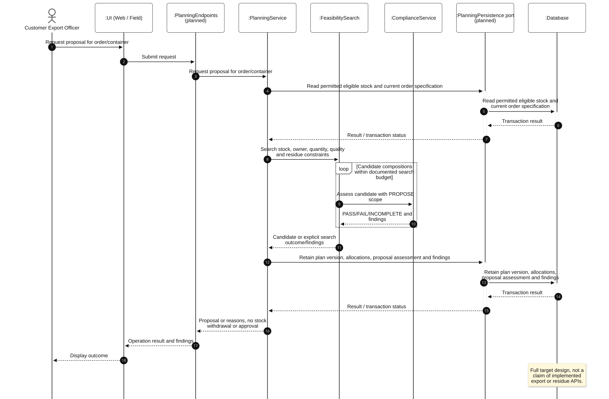

Diagram 21: Request feasible blend proposal Sequence Diagram

#### 3.6.3 Approve/reject or re-review plan scope

Diagram 22: Approve/reject or re-review plan scope Sequence Diagram

### 3.7 Container Loading, CLOSE and Shipment Documentation

**Design status:** Planned full container loading/CLOSE/dossier design, retaining all original quantity and assessment requirements.

Use cases: UC-31, UC-32, UC-33, UC-34, UC-35. Loading withdraws the exact approved output stock; CLOSE reassesses every committed loading across plan versions. Documentation preserves the unique successful whole-container closing snapshot.

#### 3.7.1 Class Diagram


Diagram 23: Container Loading, CLOSE and Shipment Documentation Class Diagram

**Class Specifications**

| No | Class | Attributes | Operations |
| --- | --- | --- | --- |
| 01 | Container | UUID container_id; UUID order_id; String internal_code; String container_number; String seal_number; Decimal target_mass_kg; String status | canAcceptLoading() Boolean; hasExactTarget(loadedKg) Boolean |
| 02 | ContainerLoading | UUID loading_id; UUID container_id; UUID plan_id; UUID recorded_by; UUID event_id; String status; DateTime loaded_at | totalLoadedMass(items) Decimal |
| 03 | LoadingAllocation | UUID loading_allocation_id; UUID loading_id; UUID source_allocation_id; UUID reservation_id; Decimal loaded_kg; Integer bag_count | matchesOutputReservation(reservation) Boolean |
| 04 | PlanOutputAllocation | UUID plan_output_id; UUID plan_id; UUID allocation_id; UUID output_id; Decimal assigned_kg | matchesOutputAndPlan(output, plan) Boolean |
| 05 | StockReservation | UUID reservation_id; UUID plan_allocation_id; UUID plan_output_id; Decimal reserved_kg; Decimal consumed_kg; Decimal released_kg | outstandingMass() Decimal; canConsume(massKg) Boolean |
| 06 | ComplianceAssessment | UUID assessment_id; UUID container_id; UUID plan_id; UUID loading_id; String purpose; String verdict; UUID mrl_version_id; UUID safety_margin_policy_id; String immutable_basis_ref | isPassFor(scope, revision) Boolean |
| 07 | ComplianceDossier | UUID dossier_id; UUID container_id; UUID closing_assessment_id; UUID created_by; DateTime finalized_at; String immutable_snapshot_ref | matchesClosingAssessment(assessment) Boolean |
| 08 | DossierSupplement | UUID supplement_id; UUID dossier_id; UUID added_by; String evidence_ref; String reason; DateTime added_at | validateEvidenceAndReason() ValidationResult |
| 09 | ShipmentDocument | UUID document_id; UUID container_id; UUID created_by; String document_type; Integer version_no; String immutable_file_ref; DateTime issued_at | matchesContainer(containerId) Boolean |

Table 10: Container Loading, CLOSE and Shipment Documentation Class Specifications

**Design constraints:**

- Loading, metadata and CLOSE are separate outcomes. Updating a seal number does not post stock or close a container.
- CLOSE scope is container-wide: container_id required; plan_id and loading_id NULL. Its basis includes every committed loading and historical authorization, even when P1 no longer has new-loading authority.
- Require total loaded mass exactly target_mass_kg and sum completed-container mass ≤ order.required_mass_kg. No processing tolerance applies to shipment quantity.
- Commit PASS CLOSE assessment, CLOSED state and unique dossier atomically. After CLOSE, new evidence becomes a supplement; retrieval never regenerates the closing snapshot.
- Store immutable snapshot bytes transactionally for the initial design, or persist content durably before committing its database reference; unreferenced prepared content is harmless and cannot authorize CLOSE. No successful dossier may refer to missing content.
- UC-33 shares DocumentService access/versioning structure; exports persist document type/version/file reference. This does not add a buyer portal, EPCIS integration or customs authorization.

#### 3.7.2 Record loading from the approved plan output

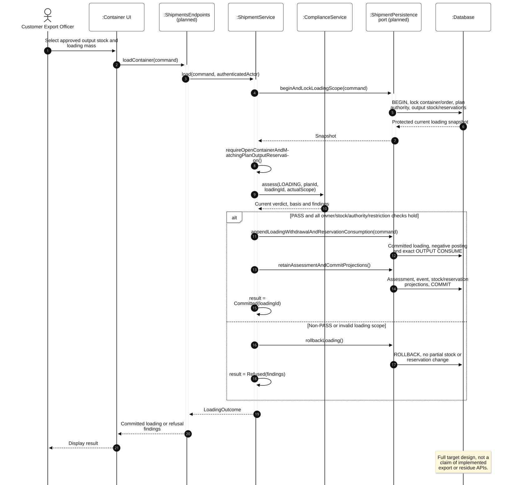

Diagram 24: Record loading from the approved plan output Sequence Diagram

#### 3.7.3 Close the complete container across plan versions

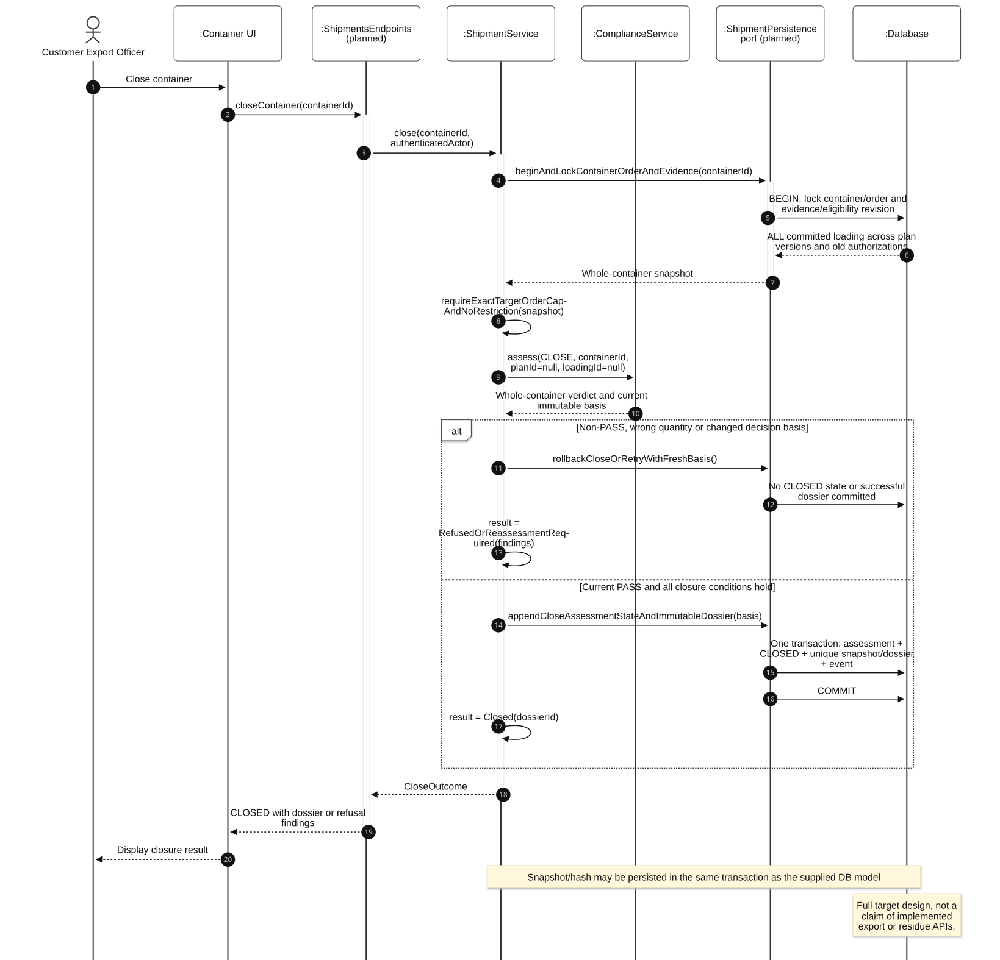

Diagram 25: Close the complete container across plan versions Sequence Diagram

#### 3.7.4 Retrieve dossier and append later evidence

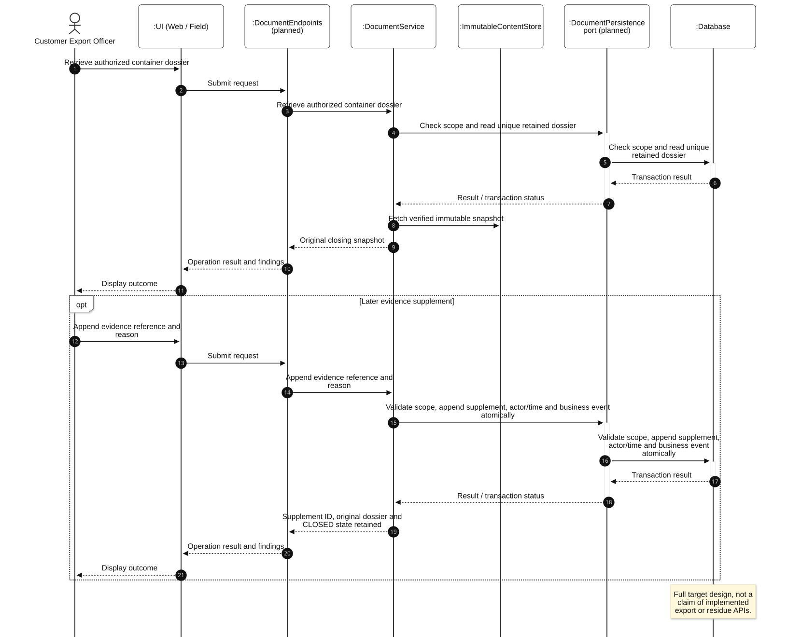

Diagram 26: Retrieve dossier and append later evidence Sequence Diagram

### 3.8 Bidirectional Traceability, HOLD and Retained Alerts

**Design status:** Mixed: explicit lot HOLD, scoped notices/handling and root-source contributions exist. Full source-to-container traversal, container HOLD and downstream authority invalidation remain planned.

Use cases: UC-24, UC-25, UC-26, UC-27, UC-28. Trace recorded contributions in both directions. Customer Manager explicitly chooses each lot/container HOLD; scoped in-app notices and operational handling retain the restriction.

#### 3.8.1 Class Diagram


Diagram 27: Bidirectional Traceability, HOLD and Retained Alerts Class Diagram

**Class Specifications**

| No | Class | Attributes | Operations |
| --- | --- | --- | --- |
| 01 | Lot | UUID lot_id; UUID company_id; UUID commodity_id; String lot_code; String stage; DateTime created_at | belongsTo(companyId) Boolean; isStageCompatible(operation) Boolean |
| 02 | MassContribution | UUID contribution_id; UUID input_id; UUID output_id; Decimal attributed_output_kg | validateAttribution(outputKg) ValidationResult |
| 03 | Container | UUID container_id; UUID order_id; String internal_code; String container_number; String seal_number; Decimal target_mass_kg; String status | canAcceptLoading() Boolean; hasExactTarget(loadedKg) Boolean |
| 04 | Hold | UUID hold_id; UUID company_id; UUID lot_id; UUID container_id; UUID lab_result_id; UUID ordered_by; String reason | hasExactlyOneTarget() Boolean; blocks(action, target) Boolean |
| 05 | HoldNotification | UUID notification_id; UUID hold_id; UUID recipient_id; String message; DateTime created_at; DateTime read_at | belongsToRecipient(userId) Boolean |
| 06 | HoldHandlingEvent | UUID handling_id; UUID hold_id; UUID recorded_by; String action; String evidence_ref; String note; DateTime recorded_at | isPermittedHandling(action) Boolean |

Table 11: Bidirectional Traceability, HOLD and Retained Alerts Class Specifications

**Design constraints:**

- Forward traversal visits every reachable recorded lot/plan/container; backward traversal sums contributions from all committed container loading. Results describe accounting shares, not identified grains.
- UC-25 allows Customer Export Officer to trace affected targets; UC-24 is Customer Manager source-contribution trace. Trace results do not automatically issue HOLD.
- HOLD blocks relevant planning/reservation/production consumption/loading/CLOSE; authorized ledgered isolation transfer remains allowed. Acknowledgement, response and read status do not release restrictions.
- HOLD and correctly scoped in-app notices commit together; no email/SMS or independent notification service is introduced. Reservation RELEASE is unrelated to HOLD release.

#### 3.8.2 Forward or backward traversal

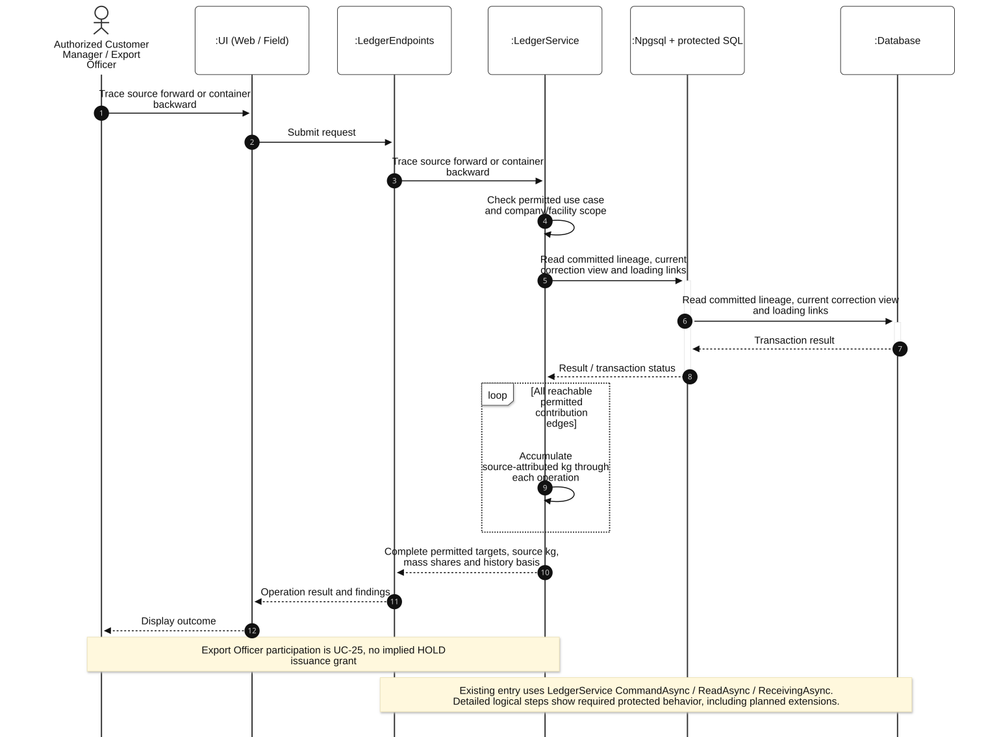

Diagram 28: Forward or backward traversal Sequence Diagram

#### 3.8.3 Issue HOLD, retain notices and handle restriction

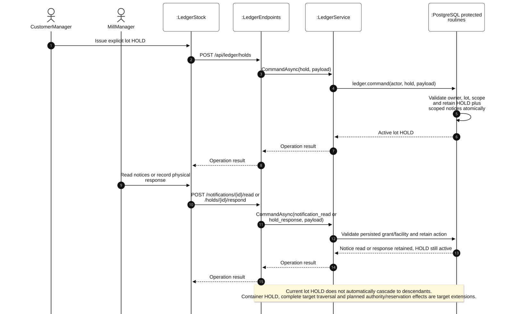

Diagram 29: Issue HOLD, retain notices and handle restriction Sequence Diagram

#### 3.8.4 Issue lot or container HOLD with full target effects

This sequence retains the complete target workflow, including work not yet implemented. Existing Ledger primitives must be extended inside the same protected transaction boundary; it is not a claim that the shown future endpoint/service/port classes exist.

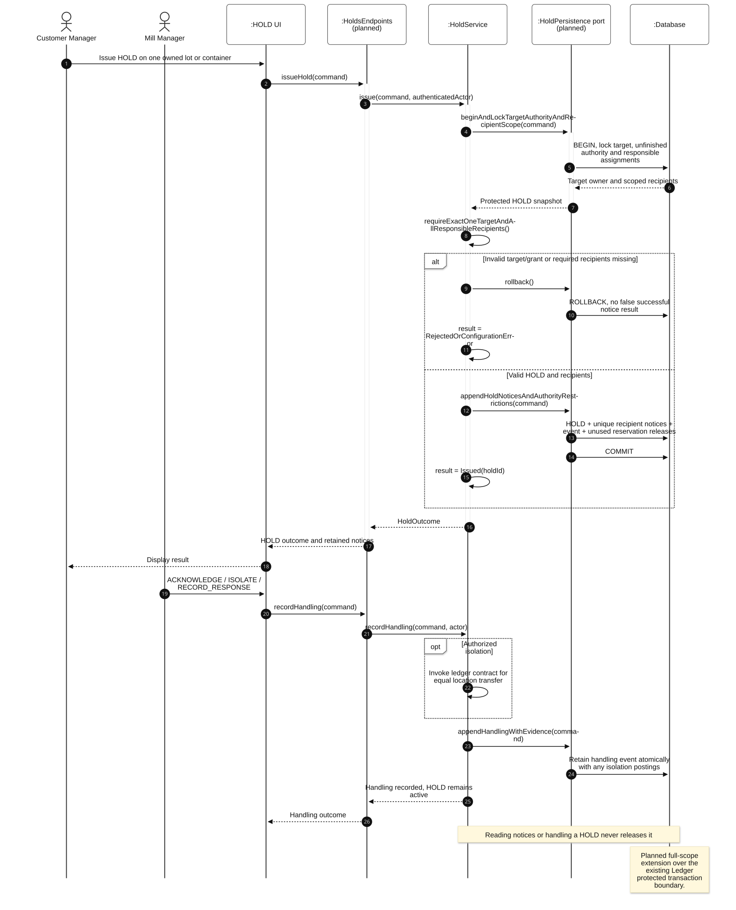

Diagram 30: Issue lot or container HOLD with full target effects Sequence Diagram

### 3.9 Business Event Search and History

**Design status:** Mixed: existing scoped ledger.read history and module audit records; combined cross-module export/compliance history is the complete target extension.

Use cases: UC-38. All six internal roles can inspect permitted immutable business events; this shared capability never broadens action grants or inventory visibility.

#### 3.9.1 Class Diagram

Diagram 31: Business Event Search and History Class Diagram

**Class Specifications**

| No | Class | Attributes | Operations |
| --- | --- | --- | --- |
| 01 | BusinessEvent | UUID event_id; UUID company_id; UUID actor_id; String event_type; DateTime occurred_at; DateTime recorded_at; String correlation_id | isVisibleTo(scope) Boolean |
| 02 | StateTransition | UUID transition_id; UUID event_id; UUID plan_id; UUID conversion_id; UUID container_id; String from_state; String to_state | hasExactlyOneTarget() Boolean |

Table 12: Business Event Search and History Class Specifications

**Design constraints:**

- Events cover procurement, operations/transfers/corrections, lab registration/supersession, review/reservations, loading/CLOSE, HOLD/handling, administration and traceback.
- Retain actor or system cause, typed targets, occurred/recorded times, relevant source versions and deltas/basis. No edit/delete command exists.
- Read access through Internal User does not imply stock inspection permission or logging every screen view.

#### 3.9.2 Search and inspect permitted business history

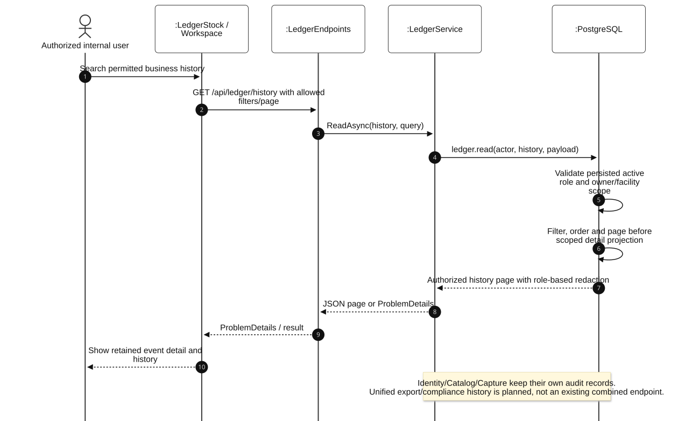

Diagram 32: Search and inspect permitted business history Sequence Diagram

