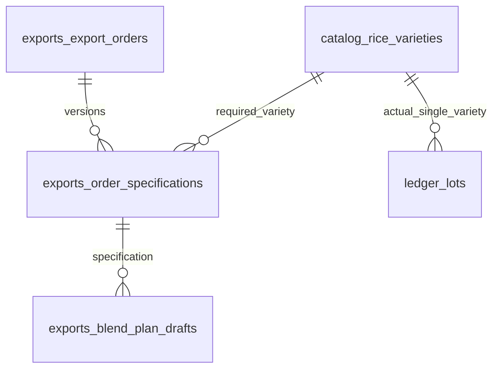

# Rice variety requirements in F14

## Order and specification contract

`POST /api/export-orders` accepts `requiredRiceVarietyId`, a UUID from `GET /api/rice-varieties`. It is required for `RICE`, `POLISHED-RICE`, and `RICE_POLISHED` orders. Other commodities may omit it when the intended product is a by-product. Drafts targeting `RAW_PADDY`, `DRIED_PADDY`, `HEAD_RICE`, `BROKEN_RICE`, or `BLENDED_RICE` require a variety regardless of the order commodity.

Order detail and specification history return `requiredRiceVarietyId` and `requiredRiceVarietyName`. The name is a display snapshot; eligibility compares UUIDs. A catalog rename does not change the required identity.

To change the variety, use the existing versioned endpoint:

```http
POST /api/export-orders/{id}/specifications
If-Match: "{current order version}"
Content-Type: application/json
```

```json
{
  "operationId": "a new operation UUID",
  "requiredRiceVarietyId": "a registered catalog variety UUID",
  "limits": [
    { "attributeId": "a quality attribute UUID", "maxValue": "14" }
  ]
}
```

The operation creates a specification version and advances the order version. Omitted or null variety preserves the previous requirement when revising limits. Empty or unregistered UUIDs return validation errors. There is no API that clears a requirement or rewrites an existing specification.

Legacy specifications remain null after migration. Revise the specification to select a variety, then create a new draft. Historical snapshots remain available; an old draft cannot calculate, propose, or approve against changed demand. Existing execution invalidation and reservation rules still apply to specification revisions.

## Candidate eligibility and calculation

Candidate responses include `riceVarietyId`, `riceVariety`, `varietyStatus`, `varietyCompatible`, and `varietyExclusion`. A plan-scoped read excludes incompatible varieties by default. `includeExcluded=true` returns them with a reason. It does not make them eligible.

| Code | Meaning |
| --- | --- |
| `VARIETY_REQUIREMENT_MISSING` | The grain target has no required variety. Add a specification version. |
| `VARIETY_MISMATCH` | The lot has a different registered variety UUID. |
| `VARIETY_UNKNOWN` | The lot lacks a usable single-variety identity. |
| `VARIETY_MIXED` | The lot contains mixed varieties. |
| `VARIETY_STOCK_INSUFFICIENT` | Available eligible product mass is below the target. This does not certify feasibility when mass is sufficient. |

The server filters before MILP and before the existing fallback search. Direct selection, blend grouping, saved-allocation rechecks, and ratio adjustments use the same eligibility rule. A forged selection sent to residue preview is rejected before F12 is called. Every optimization objective searches the same eligible set.

Variety is an eligibility constraint, not an optimization objective. Passing variety checks does not replace quantity, HOLD, reservation, compatibility, yield, quality, source laboratory evidence, or market MRL checks. F14 never dilutes a rejected source to bypass source-lab or MRL screening.

Demand snapshots and dependency fingerprints include the required UUID and sorted distinct lot identities. Proposal, approval, production review, workflow review, and export reassessment use the same identity basis. Display names do not enter the identity fingerprint. The background context includes current lot identities so changes invalidate its revision.

## Schema and deployment

Forward migration: `20261128000000_ExportRiceVarietyRequirement`.

`exports_order_specifications` gains nullable `required_rice_variety_id` and `required_rice_variety_name`. A foreign key restricts deletion of referenced catalog varieties. A check constraint requires the UUID and nonempty name snapshot to be present together. Legacy rows stay null; the migration does not guess a variety from names or source stock. The private export reassessment context also receives the required UUID and lot identities.



Ledger already projects variety through its bulk candidate read. The new narrow Ledger read obtains identities for up to 100 authorized lots in one read-only repeatable-read transaction, including spent lots needed for historical execution checks. No per-lot calls or broader grants were added.

Migration and acceptance were run on `127.0.0.1:5433/grainledger` only. Shared DB deployment and remote CI are separate work and are not implied by local results.

## Local acceptance orders

Facility: **GrainLedger Rice Variety Demo Mill (synthetic)**. The existing stock and source evidence are retained. Each order received specification version 2 with its registered variety and a new draft; no proposal was approved and no physical stock was consumed.

| Order | Requirement | Expected and observed |
| --- | --- | --- |
| `EXP-20261126-000029` | ST25, 900 kg | PASS; selected ST25 only |
| `EXP-20261126-000030` | OM5451, 900 kg | PASS; selected OM5451 only |
| `EXP-20261126-000031` | Jasmine 85, 900 kg | PASS; selected Jasmine 85 only |
| `EXP-20261126-000032` | ST25, 1,300 kg | No passing plan; did not substitute another variety |

Each case was checked through `MIN_MOISTURE`, `MIN_LOTS`, `MIN_LOCATIONS`, `RETAIN_HEAD_RICE`, and `MAX_RESIDUE_HEADROOM`. Old drafts returned conflict. The 1,300 kg case has only 1,200 kg compatible ST25 head rice; the fixture compatibility does not permit broken rice as an input.

On the FE, create or open an export order and select **Required rice variety**. For an existing order use **New version**, save the variety with its quality limits, then create a current draft. The draft displays the requirement, candidate rows display actual varieties, and calculation shows excluded lots and reasons.


## Input weighing step

F14 allocations now use [whole-kilogram planning](f14-whole-kg-planning.md). Variety eligibility, source laboratory evidence, MRL and quality checks still apply; integer kg is an additional input requirement, not a replacement for those checks.
